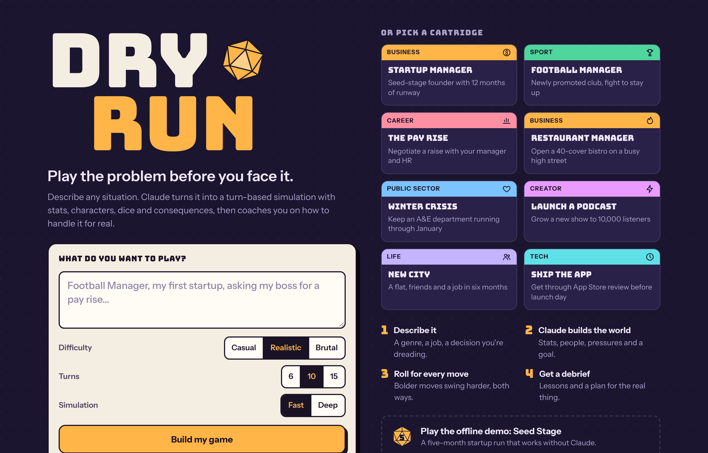
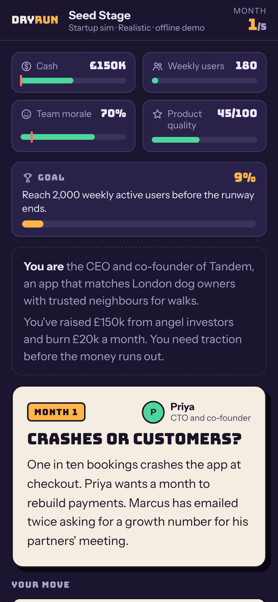
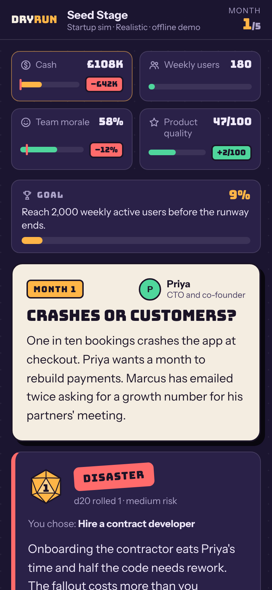
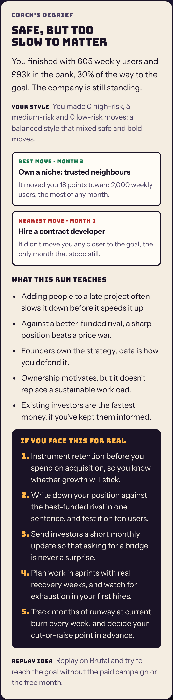

# Dry Run

**Play the problem before you face it.**

Dry Run turns any situation into a turn-based simulation you can play. That can be a management genre like *Football Manager* or *Startup Manager*, or a real problem like asking for a pay rise or running an A&E department through a winter surge. Claude builds the world (stats, characters, a goal and a timeline), you choose a move each turn, a d20 decides how it lands, and the game ends with a coach's debrief and a step-by-step plan for the real thing.

**▶ [Play the live prototype](https://claude.ai/artifact/6BR3oecAHanYis4C3HKdbh)** (runs inside Claude; building a game uses the player's own Claude account)

  

  

  
  
  

## Why

Most hard situations, like a negotiation, a launch or a crisis, only happen to you once or twice, so you never get to practise them. Games are how people practise safely. Dry Run lets you rehearse a problem a few times, see which kinds of decisions hold up, and walk in with a plan.

## How it plays

1. **Describe it.** A genre, a job, or a decision you're dreading. You can also pick one of eight example cartridges.
2. **Claude builds the world.** It sets 4–5 stats that pull against each other, some with a lose condition (cash hits zero, you drop into the relegation zone). It also adds characters with their own agendas, a measurable goal, and a time unit that fits the problem (weeks, months, matchweeks).
3. **Each turn offers three moves:** one low-risk, one medium, one high. You can also write your own move.
4. **Roll for it.** The page rolls a d20, adjusted for difficulty, and maps it to an outcome tier. Claude then narrates the result within that tier and returns the stat changes.
5. **Debrief.** When the game ends, a coach reviews every decision. It judges the decisions rather than the dice, and picks out your best and weakest move, your decision style, transferable lessons, and a numbered plan for facing the real situation.

### Dice and risk

| Risk | Disaster | Setback | Mixed | Success | Breakthrough | Good roll (Realistic) | Stat swings |
|---|---|---|---|---|---|---|---|
| Low | – | 1–3 | 4–8 | 9–19 | 20 | 60% | small (3–8% of range) |
| Medium | 1–2 | 3–6 | 7–11 | 12–18 | 19–20 | 45% | moderate (8–15%) |
| High | 1–5 | 6–9 | 10–12 | 13–16 | 17–20 | 40% | large (12–30%) |

The difficulty modifier is applied to the roll: Casual +2, Realistic 0, Brutal −3. A natural 20 is always a breakthrough. The page shows the odds on every choice, so each pick is an explicit risk-versus-reward call.

### Design principle: the page owns the rules, Claude owns the world

Claude never decides whether you win. It returns structured JSON (outcome text, stat deltas, goal progress and the next event). The page validates that JSON, clamps every change, applies it, and checks the win and lose conditions itself. This keeps the game fair and reproducible, even when the model is creative.

## Tech

- One self-contained HTML/CSS/JS file (`index.html`), with no build step and no dependencies.
- Claude is reached through the Claude artifact runtime's `sample` capability (`sample.json`), with structured-output prompts for world-building, turn resolution and the debrief.
- A fast model tier runs the turns and a deeper tier builds the world and writes the debrief. You can switch the turns to the deeper tier with the "Deep" setting.
- Game state autosaves to `localStorage`. The page survives live republishes via the artifact hot-reload snapshot.
- An offline demo (*Seed Stage*, a 5-month startup run) plays without Claude.

## Run it

- **In Claude:** open the [live prototype](https://claude.ai/artifact/6BR3oecAHanYis4C3HKdbh).
- **Locally:** download `index.html` and open it in a browser. Only the offline demo works outside Claude, because building and running custom games needs the Claude artifact runtime.

## Roadmap: from artifact to app

- [x] **v0.1: Claude artifact prototype.** Game generation, d20 resolution, custom moves, debrief, offline demo, mobile-first UI.
- [ ] **Standalone web app.** Replace `claude.use("sample")` with a small backend that calls the Claude API (keys server-side, rate limiting), so it runs anywhere.
- [ ] **Accounts and cloud saves.** Keep your runs and compare replays of the same world.
- [ ] **Shareable worlds.** Send a friend the same scenario and starting position, then compare debriefs.
- [ ] **Scenario library.** Curated, tested scenarios for careers, founders, managers and public services.
- [ ] **Team and classroom mode.** A group rehearses the same scenario, and a facilitator sees the decision patterns.
- [ ] **Mobile app.** Starting as a PWA, then a store release.

See [CHANGELOG.md](CHANGELOG.md) for what changed in each version.

## Author

Built by [Amirreza Nadimi Shahraki](https://github.com/amirbnash-star). Prototyped with Claude.
